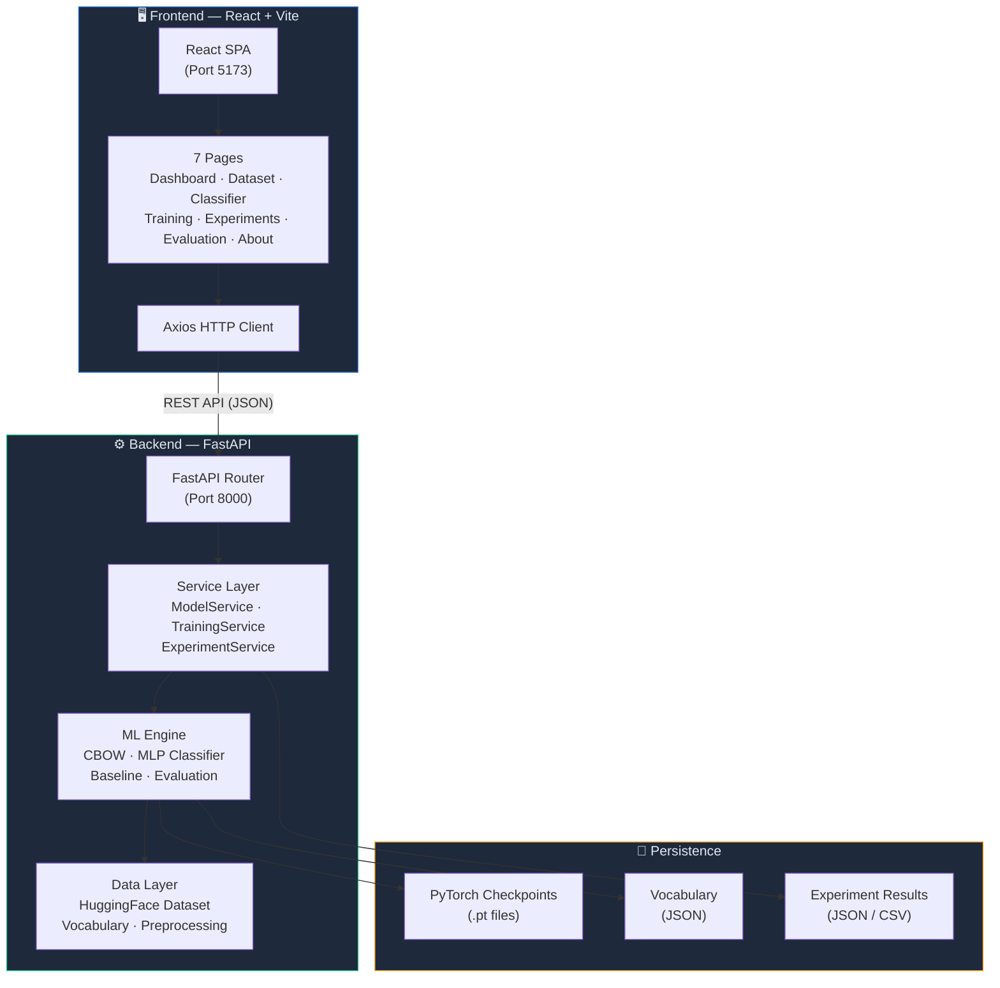
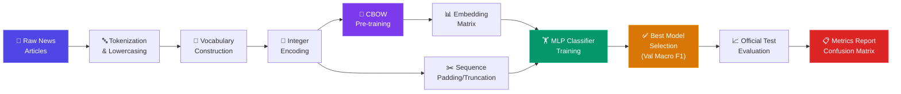
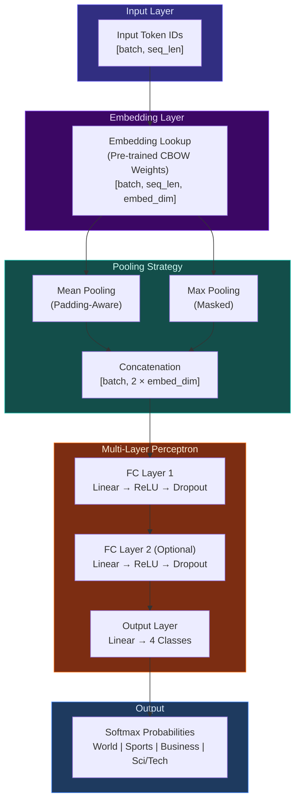
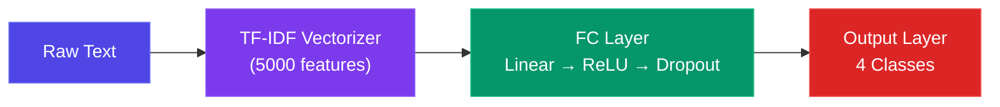
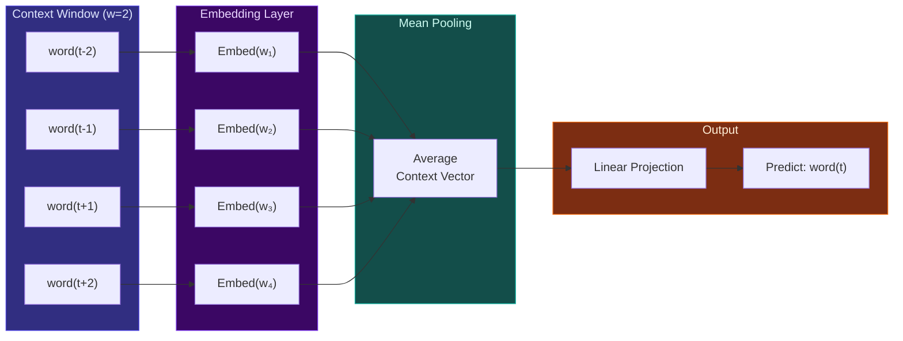
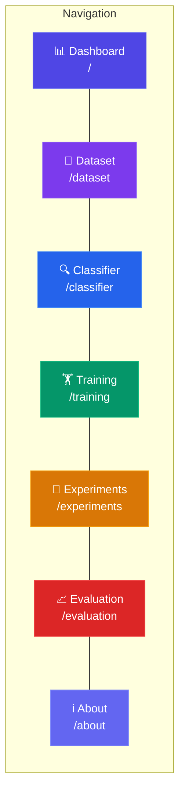
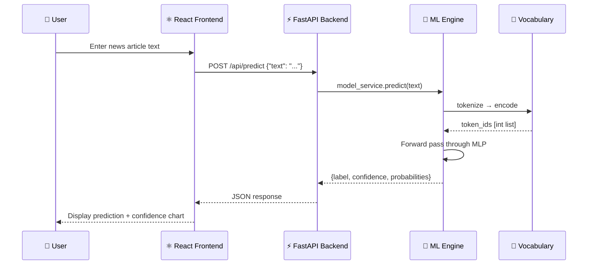

<p align="center">
  
  
  
  
  
  
</p>

<h1 align="center">📰 AG News Classifier</h1>
<h3 align="center">ANN-Based Classification of AG News Using CBOW Embedding + MLP</h3>

<p align="center">
  A full-stack, end-to-end academic machine learning application that classifies news articles into <b>4 categories</b> — <i>World, Sports, Business, Sci/Tech</i> — using Continuous Bag-of-Words (CBOW) distributed word representations and a Multi-Layer Perceptron (MLP) neural network, served via a FastAPI backend and a React dashboard.
</p>

---

## 📑 Table of Contents

- [Project Overview](#-project-overview)
- [System Architecture](#-system-architecture)
- [ML Pipeline](#-ml-pipeline)
- [Model Architecture](#-model-architecture)
- [Technology Stack](#-technology-stack)
- [Project Structure](#-project-structure)
- [Getting Started](#-getting-started)
- [API Reference](#-api-reference)
- [Frontend Pages](#-frontend-pages)
- [Running Tests](#-running-tests)
- [Methodology](#-methodology)
- [License](#-license)

---

## 🎯 Project Overview

| Attribute | Details |
|-----------|---------|
| **Dataset** | [Mikami063/ag_news](https://huggingface.co/datasets/Mikami063/ag_news) from Hugging Face |
| **Train Split** | 120,000 articles |
| **Test Split** | 7,600 articles |
| **Categories** | `0: World` · `1: Sports` · `2: Business` · `3: Sci/Tech` |
| **Proposed Model** | CBOW Embeddings → Mean/Max Pooling → MLP Classifier |
| **Baseline Model** | TF-IDF Vectorizer → MLP Classifier |
| **Optimizers** | Mini-Batch SGD (with momentum) · Adam |
| **Evaluation** | Accuracy, Macro F1, Confusion Matrix, Per-Class Precision/Recall |

---

## 🏗️ System Architecture

The application follows a decoupled **client-server architecture** with a React SPA frontend communicating with a FastAPI backend over REST APIs.



---

## 🔬 ML Pipeline

The complete machine learning pipeline from raw text to prediction follows this flow:



### Pipeline Stages in Detail

| Stage | Description |
|-------|-------------|
| **1. Data Loading** | Stream the AG News dataset from Hugging Face; split train into train/val (90/10) |
| **2. Preprocessing** | Lowercase, tokenize, remove punctuation and stopwords |
| **3. Vocabulary** | Build word-to-index mapping from training corpus with `<PAD>` (0) and `<UNK>` (1) tokens |
| **4. CBOW Pre-training** | Train a CBOW network to learn dense word embeddings from context-target pairs |
| **5. Classifier Training** | Initialize MLP embedding layer with CBOW weights; train with Cross-Entropy loss |
| **6. Model Selection** | Save the best checkpoint based on validation Macro F1 score |
| **7. Evaluation** | Evaluate on the held-out official test set; generate confusion matrix and per-class report |

---

## 🧠 Model Architecture

### Proposed Model: CBOW + MLP Classifier



### Baseline Model: TF-IDF + MLP



### CBOW Pre-training Architecture



---

## 🛠️ Technology Stack

### Backend
| Technology | Purpose |
|------------|---------|
| **Python 3.10+** | Core language |
| **FastAPI** | Async REST API framework |
| **Uvicorn** | ASGI web server |
| **PyTorch 2.2+** | Deep learning framework |
| **Hugging Face Datasets** | Dataset loading and streaming |
| **Scikit-learn** | TF-IDF vectorizer, metrics |
| **NumPy / Pandas** | Numerical computation |

### Frontend
| Technology | Purpose |
|------------|---------|
| **React 19** | Component-based UI |
| **Vite 8** | Lightning-fast bundler and dev server |
| **Tailwind CSS 4** | Utility-first CSS styling |
| **Recharts** | Data visualization and charts |
| **React Router v7** | Client-side routing |
| **Lucide React** | Icon library |
| **Axios** | HTTP client |

---

## 📁 Project Structure

```
ag-news-classifier/
│
├── backend/                          # FastAPI Backend
│   ├── app/
│   │   ├── api/
│   │   │   └── endpoints.py          # All REST API route handlers
│   │   ├── ml/
│   │   │   ├── baseline.py           # TF-IDF + MLP baseline model
│   │   │   ├── cbow.py               # CBOW & Negative Sampling models
│   │   │   ├── classifier.py         # CBOW-MLP classifier architecture
│   │   │   ├── data_loader.py        # HuggingFace dataset management
│   │   │   ├── evaluate.py           # Test set evaluation pipeline
│   │   │   ├── metrics.py            # Accuracy, F1, confusion matrix
│   │   │   ├── predict.py            # Single-text inference pipeline
│   │   │   ├── preprocessing.py      # Tokenization utilities
│   │   │   ├── train.py              # Complete training pipeline
│   │   │   └── vocabulary.py         # Word ↔ Index mapping
│   │   ├── schemas/
│   │   │   └── schemas.py            # Pydantic request/response models
│   │   ├── services/
│   │   │   ├── experiment_service.py  # Experiment management
│   │   │   ├── model_service.py       # Model loading & prediction
│   │   │   └── training_service.py    # Background training jobs
│   │   ├── utils/
│   │   │   └── persistence.py         # JSON/CSV result persistence
│   │   ├── config.py                  # Paths, labels, device config
│   │   └── main.py                    # FastAPI app entry point
│   ├── artifacts/
│   │   ├── models/                    # Saved PyTorch model weights (.pt)
│   │   └── vocab/                     # Serialized vocabulary files
│   ├── results/
│   │   ├── experiments.json           # Experiment history
│   │   └── latest_evaluation.json     # Latest test evaluation results
│   ├── tests/
│   │   ├── test_api.py                # API endpoint tests
│   │   ├── test_dataset.py            # Dataset loading tests
│   │   ├── test_ml.py                 # ML model unit tests
│   │   └── test_smoke.py              # End-to-end smoke tests
│   └── requirements.txt               # Python dependencies
│
├── frontend/                          # React Frontend
│   ├── src/
│   │   ├── components/
│   │   │   ├── Header.jsx             # Top navigation bar
│   │   │   └── Sidebar.jsx            # Side navigation menu
│   │   ├── pages/
│   │   │   ├── AboutPage.jsx          # Project documentation page
│   │   │   ├── ClassifierPage.jsx     # Live prediction interface
│   │   │   ├── Dashboard.jsx          # System overview dashboard
│   │   │   ├── DatasetPage.jsx        # Dataset exploration & stats
│   │   │   ├── EvaluationPage.jsx     # Test evaluation & metrics
│   │   │   ├── ExperimentsPage.jsx    # Controlled experiments
│   │   │   └── TrainingPage.jsx       # Model training controls
│   │   ├── services/
│   │   │   └── api.js                 # Axios API client
│   │   ├── App.jsx                    # Root component & routing
│   │   └── main.jsx                   # React DOM entry
│   ├── index.html                     # HTML shell
│   ├── package.json                   # Node.js dependencies
│   └── vite.config.js                 # Vite configuration
│
├── .gitignore
└── README.md                          # ← You are here
```

---

## 🚀 Getting Started

### Prerequisites

| Requirement | Version |
|-------------|---------|
| Python | 3.10+ |
| Node.js | 18+ |
| pip | Latest |
| npm | Latest |

### 1️⃣ Clone the Repository

```bash
git clone https://github.com/<your-username>/ag-news-classifier.git
cd ag-news-classifier
```

### 2️⃣ Backend Setup

```bash
# Navigate to backend
cd backend

# (Recommended) Create a virtual environment
python -m venv venv

# Activate — Windows PowerShell
.\venv\Scripts\Activate.ps1

# Activate — macOS/Linux
source venv/bin/activate

# Install dependencies
pip install -r requirements.txt

# Start the FastAPI server
python -m uvicorn app.main:app --host 0.0.0.0 --port 8000 --reload
```

> **Backend is now live at:** http://localhost:8000
> **Swagger API Docs:** http://localhost:8000/docs

### 3️⃣ Frontend Setup

Open a **new terminal** window:

```bash
# Navigate to frontend
cd frontend

# Install packages
npm install

# Start dev server
npm run dev
```

> **Dashboard is now live at:** http://localhost:5173

---

## 📡 API Reference

All endpoints are prefixed with `/api`.

### Health & Status

| Method | Endpoint | Description |
|--------|----------|-------------|
| `GET` | `/api/health` | System health, dataset status, model availability |

### Dataset

| Method | Endpoint | Description |
|--------|----------|-------------|
| `GET` | `/api/dataset/info` | Dataset metadata (splits, sizes, labels) |
| `GET` | `/api/dataset/examples?split=train&page=1&page_size=20` | Paginated article samples |
| `GET` | `/api/dataset/distribution` | Class distribution per split |

### Prediction

| Method | Endpoint | Description |
|--------|----------|-------------|
| `POST` | `/api/predict` | Classify a news article; returns label + confidence scores |

**Request body:**
```json
{
  "text": "NASA launches new Mars rover mission to explore ancient riverbeds"
}
```

**Response:**
```json
{
  "label": "Sci/Tech",
  "label_id": 3,
  "confidence": 0.9231,
  "probabilities": {
    "World": 0.0312,
    "Sports": 0.0089,
    "Business": 0.0368,
    "Sci/Tech": 0.9231
  },
  "latency_ms": 12.4
}
```

### Training

| Method | Endpoint | Description |
|--------|----------|-------------|
| `POST` | `/api/train` | Launch a background training job |
| `GET` | `/api/train/status/{job_id}` | Poll training progress |

### Experiments

| Method | Endpoint | Description |
|--------|----------|-------------|
| `POST` | `/api/experiments` | Run a named experiment |
| `GET` | `/api/experiments` | List all experiments |
| `GET` | `/api/experiments/{id}` | Get experiment details |

### Evaluation

| Method | Endpoint | Description |
|--------|----------|-------------|
| `GET` | `/api/evaluate` | Full evaluation results |
| `GET` | `/api/evaluate/confusion-matrix` | Confusion matrix data |
| `GET` | `/api/evaluate/report` | Per-class precision/recall/F1 |
| `GET` | `/api/evaluate/errors?page=1&page_size=20` | Misclassified examples |

### Export

| Method | Endpoint | Description |
|--------|----------|-------------|
| `GET` | `/api/results/export` | Download experiments as CSV |

---

## 🖥️ Frontend Pages



| Page | Route | Features |
|------|-------|----------|
| **Dashboard** | `/` | System health, dataset overview, latest metrics, quick-action cards |
| **Dataset Explorer** | `/dataset` | Class distributions (bar charts), category mapping, paginated article browser |
| **News Classifier** | `/classifier` | Live prediction with sample articles, custom text input, confidence scores, probability bars, latency display |
| **Model Training** | `/training` | Optimizer selection (SGD/Adam), hyperparameter controls (LR, batch size, epochs, embedding dim, context window), live loss curve |
| **Experiments** | `/experiments` | Baseline vs Proposed comparison, learning rate trials, optimizer comparisons, interactive charts, CSV export |
| **Evaluation** | `/evaluation` | Confusion matrix heatmap, per-class P/R/F1, parameter count, false positive/negative inspection |
| **About** | `/about` | Mathematical formulations, data flow diagrams, architecture documentation |

---

## 🧪 Running Tests

The project includes a comprehensive test suite covering dataset loading, preprocessing, model forward passes, API endpoints, and end-to-end smoke tests.

```bash
cd ag-news-classifier
pytest backend/tests/ -v
```

| Test File | Coverage |
|-----------|----------|
| `test_dataset.py` | Dataset loading and split verification |
| `test_ml.py` | CBOW forward pass, classifier dimensions, vocabulary encoding |
| `test_api.py` | API endpoint response codes and schemas |
| `test_smoke.py` | End-to-end training → prediction flow |

---

## 📐 Methodology

### CBOW Embedding Training

The Continuous Bag-of-Words model learns dense word representations by predicting a **target word** from its surrounding **context words** within a sliding window.

```
Objective:  maximize P(w_t | w_{t-k}, ..., w_{t-1}, w_{t+1}, ..., w_{t+k})

Loss:       CrossEntropyLoss(Linear(mean(Embed(context))), target)
```

### MLP Classification

The classifier uses pre-trained CBOW embeddings with padding-aware pooling:

```
1. Embed:    E = Embedding(input_ids)           →  [B, L, D]
2. Pool:     p = MeanPool(E) ⊕ MaxPool(E)      →  [B, 2D]
3. Hidden:   h = Dropout(ReLU(FC₁(p)))          →  [B, H]
4. Output:   ŷ = FC_out(h)                      →  [B, 4]
5. Loss:     ℒ = CrossEntropy(ŷ, y)
```

### Training Strategy

| Component | Detail |
|-----------|--------|
| **Loss Function** | Cross-Entropy Loss |
| **Optimizers** | Mini-Batch SGD (momentum=0.9) or Adam |
| **LR Schedule** | Cosine Annealing (η_min = 0.1 × η) |
| **Gradient Clipping** | Max norm = 5.0 |
| **Model Selection** | Best validation Macro F1 checkpoint |
| **Regularization** | Dropout (configurable) + Weight Decay |

### Evaluation Protocol

- The **official test set** (7,600 articles) is strictly held out and **never** used during training or validation.
- Metrics reported: **Accuracy**, **Macro F1**, **Per-class Precision/Recall/F1**, and **Confusion Matrix**.

---

## 🔁 Request-Response Flow

A complete lifecycle of a user prediction request:



---

## 🤝 Contributing

1. Fork the repository
2. Create your feature branch (`git checkout -b feature/amazing-feature`)
3. Commit changes (`git commit -m 'Add amazing feature'`)
4. Push to the branch (`git push origin feature/amazing-feature`)
5. Open a Pull Request

---

## 📄 License

This project is created for **academic purposes**. Feel free to use it for learning and research.

---

<p align="center">
  Built with ❤️ using <b>PyTorch</b> + <b>FastAPI</b> + <b>React</b>
</p>
